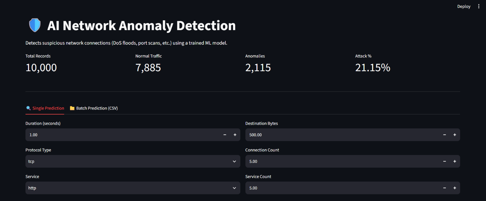
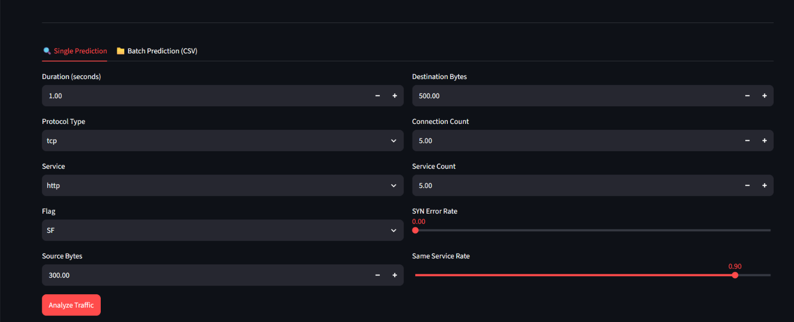
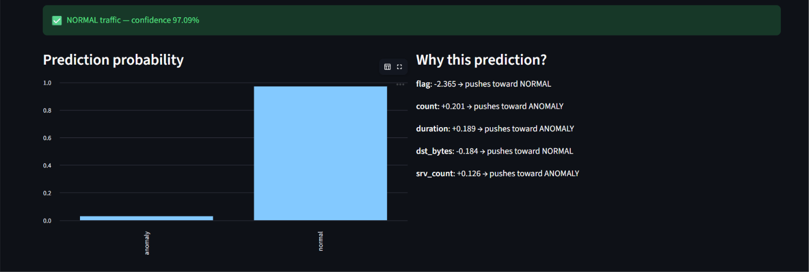

# 🛡️ AI Network Anomaly Detection

An AI-powered network intrusion detection system that classifies network traffic as **Normal** or **Anomalous** using machine learning.

The project implements a complete ML pipeline, including data preprocessing, feature engineering, model training, evaluation, explainability using SHAP, and an interactive Streamlit dashboard for network traffic predictions.

## 🚀 Live Demo

**Try the application:** [AI Network Anomaly Detection](https://ai-network-anomaly-dheeraj.streamlit.app/)

**GitHub Repository:** [AI Network Anomaly Detection](https://github.com/dheerajkumar25-dev/AI-Network-Anomaly-Detection)

## 📸 Application Screenshots

### 1. Main Dashboard



### 2. Traffic Prediction Input



### 3. Prediction Results & Model Explainability



## 🚀 Features

- 🌐 Detect anomalous network traffic using Machine Learning.
- 🤖 XGBoost-based intrusion detection model.
- 📊 Interactive Streamlit dashboard.
- 📈 Model evaluation using Accuracy, Precision, Recall, and F1-score.
- 🔍 SHAP-based model explainability.
- 📂 Batch prediction using CSV files.
- ⚡ Real-time single-record prediction.
- 📦 Model versioning for experiment tracking.
- 🐳 Docker support.

## 🛠️ Tech Stack

| Category | Technologies |
|---|---|
| Language | Python |
| Machine Learning | XGBoost, Scikit-learn |
| Data Processing | Pandas, NumPy |
| Explainability | SHAP |
| Visualization | Plotly, Matplotlib |
| Frontend | Streamlit |
| Deployment | Docker, Streamlit Community Cloud |

## 🧪 Testing

This project has been tested locally on **Windows (Python 3.12)**.

### Verified Components

- ✅ Data preprocessing
- ✅ Feature engineering
- ✅ Feature encoding and scaling
- ✅ XGBoost model training
- ✅ Model evaluation
- ✅ SHAP explainability
- ✅ Streamlit dashboard
- ✅ Single prediction
- ✅ Batch prediction
- ✅ Model versioning

## 🔄 Project Pipeline

### Workflow

1. Load the NSL-KDD dataset or a compatible dataset.
2. Clean and preprocess the data.
3. Encode categorical features.
4. Scale numerical features.
5. Train an XGBoost classifier.
6. Evaluate the model using Accuracy, Precision, Recall, and F1-score.
7. Save the trained model, encoders, and scaler.
8. Generate SHAP explanations for model predictions.
9. Perform real-time single or batch predictions.
10. Display results through the Streamlit dashboard.

## 🏗️ Design Decisions

The project separates preprocessing, training, prediction, and visualization into independent modules for better maintainability and scalability.

- Data preprocessing is reusable during both training and inference.
- Encoders and scalers are saved to ensure consistent predictions.
- SHAP is integrated to improve model interpretability.
- Model versioning tracks trained models.
- Streamlit provides an intuitive interface for real-time inference.

## 📂 Dataset

The project follows the feature schema of the **NSL-KDD intrusion detection dataset**.

When the original dataset is unavailable, the preprocessing pipeline automatically generates a synthetic dataset with the same feature structure for demonstration and development purposes.

### Using the Original Dataset

1. Download `KDDTrain+.txt` from the NSL-KDD dataset.
2. Place it inside:

```text
data/raw/
```

3. Run the preprocessing script:

```powershell
python src/preprocess.py
```

The preprocessing script automatically detects and processes the original dataset if available.

## 📁 Project Structure

```text
AI-Network-Anomaly-Detection/
│
├── app/
│   └── app.py                  # Streamlit dashboard
│
├── data/
│   ├── raw/                    # Original NSL-KDD dataset
│   └── processed/              # Preprocessed dataset
│
├── models/
│   ├── versions/               # Versioned trained models
│   ├── model.pkl               # Latest trained XGBoost model
│   ├── scaler.pkl              # Saved feature scaler
│   ├── encoders.pkl             # Saved categorical encoders
│   └── version_history.json    # Model version history
│
├── notebooks/
│   └── EDA.ipynb               # Exploratory Data Analysis
│
├── reports/
│   ├── images/                 # Evaluation plots
│   ├── metrics.txt             # Model evaluation metrics
│   └── dataset_summary.json    # Dataset statistics
│
├── src/
│   ├── utils.py                # Shared utility functions
│   ├── preprocess.py           # Data preprocessing
│   ├── train.py                # Model training and evaluation
│   └── predict.py              # Single and batch prediction
│
├── docs/
│   └── images/
│       ├── dashboard.png
│       ├── prediction-explanation.png
│       └── prediction-input.png
│
├── requirements.txt
├── Dockerfile
└── README.md
```

## ⚙️ Getting Started

### 1. Clone Repository

```bash
git clone https://github.com/dheerajkumar25-dev/AI-Network-Anomaly-Detection.git

cd AI-Network-Anomaly-Detection
```

### 2. Create Virtual Environment

```powershell
python -m venv venv
```

### 3. Activate Virtual Environment

```powershell
.\venv\Scripts\Activate.ps1
```

### 4. Install Dependencies

```powershell
pip install -r requirements.txt
```

### 5. Preprocess Dataset

```powershell
python src/preprocess.py
```

### 6. Train Model

```powershell
python src/train.py
```

### 7. Run Prediction Script

```powershell
python src/predict.py
```

### 8. Launch Dashboard

```powershell
streamlit run app/app.py
```

The application will launch at:

```text
http://localhost:8501
```

## 🐳 Docker

### Build Docker Image

```powershell
docker build -t network-anomaly-detector .
```

### Run Docker Container

```powershell
docker run -p 8501:8501 network-anomaly-detector
```

Open `http://localhost:8501` to access the application.

## 📊 Model Performance

Example performance obtained during training:

| Metric | Score |
|---|---:|
| Accuracy | 98.00% |
| Precision | 98.48% |
| Recall | 91.96% |
| F1-Score | 95.11% |

*These are example training results, not a guarantee of performance on other datasets.*

## 🔮 Future Improvements

- Support additional intrusion detection datasets.
- Compare multiple machine learning models.
- Integrate deep learning-based anomaly detection.
- Add real-time packet capture support.
- Expose REST API endpoints for external integrations.
- Add automated unit tests for preprocessing and prediction modules.

## 👨‍💻 Author

**Dheeraj Kumar**

B.Tech — Electronics and Communication Engineering  
IIIT Bhagalpur

GitHub: [dheerajkumar25-dev](https://github.com/dheerajkumar25-dev)

## 📄 License

This project is intended for educational and portfolio purposes.